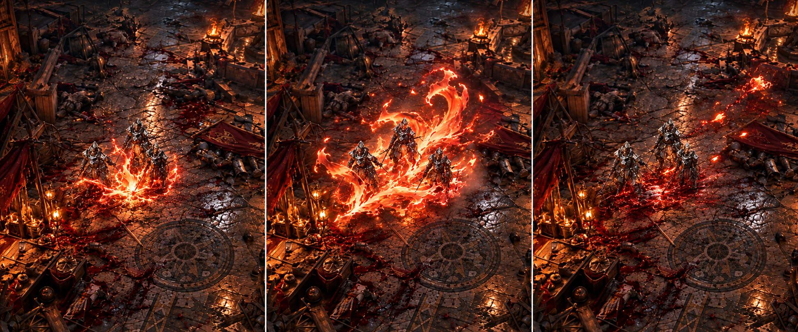
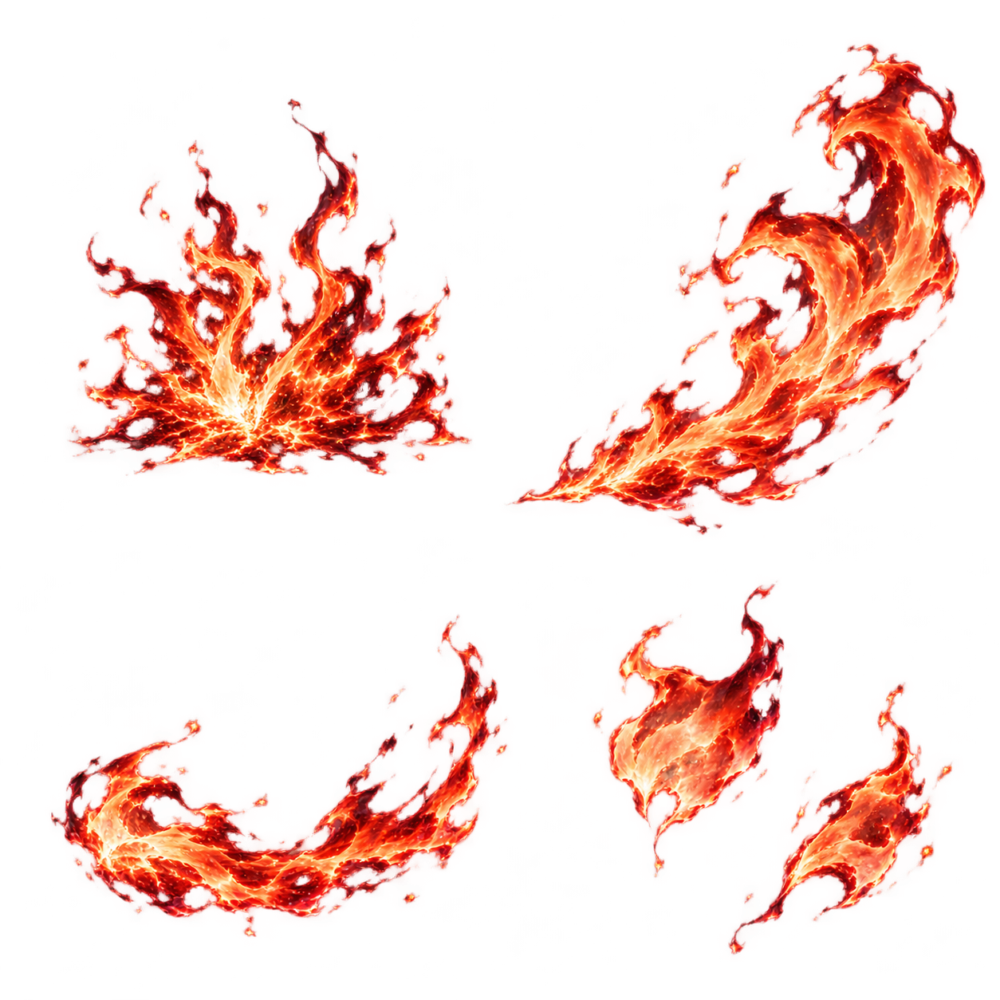

# 狐火乱舞：風にほどける、桜の気配を持つ狐火

ユーザーの「ゲームデザイン・エフェクトデザインのレビュー→コンセプト→生成→生成物のレビュー→演出効果を一貫して進める」という依頼に対する設計パッケージ。

**火が主役。桜は一瞬の裂け目の連想。火の水面は短い接地反射。** キャラ絵の髪飾り・着物の桜、身軽な投擲、速射から挟む一撃の範囲スキルを根拠にした。前の蓮状の開花は採用しない。

1. [ゲーム・キャラ・前案のレビュー、コンセプト、時間と風・光の仕様](DESIGN.md)
2. [生成した原画の自己レビュー、部分採用・不採用・再生成の理由](REVIEW.md)
3. [素材ごとの採否と、付ける動き・効果の対応](MATERIAL_MAP.md)

## 第2演出原画

これは画像生成による演出原画で、ゲームの実装キャプチャではない。中央の火の形と前後関係を参照し、長い尾・亀裂に見える地面の筋は採用しない。時刻と風の挙動は実装後の動画で検証する。

## 分離素材

左上の大きい爆発の形は全体採用しない。厳密な等分アトラスでもない。採否の詳細はMATERIAL_MAP.md。

## 出典・状態

- 参照して実見したもの：dev/cardart/src_fox.webp、guide_fox_throw.png、fox_ult_seq/08・20・36.webp、dev/reports/fox-bloom/knight-0.35.webp。
- すべての新画像はGPT Imageで生成。指示はprompts/、原本コピーはgenerated/。元生成物は/workspace/generated_images/に保持。
- 第1案：exec-63ce1098-e673-43b2-ae94-7e95ad221d4a.png。範囲・光量・火の粉の構成が不適切として、全体不採用。
- 第2案：exec-d9769be9-a1d8-47f7-8501-9fdb266ee63c.png。火の材質・局所の強弱を部分採用。未修正部分は持ち込まない。
- 分離素材：exec-3337a00b-f237-4c50-8c0c-146be580b5aa.png。役割別の自己レビューを実施し部分採用。

今回の変更は設計・生成・自己レビュー・制作仕様。新しい動きのゲーム実装、30秒リピート比較、戦闘状態テストはまだ行っていない。既存候補や標準ゲームを今回の原画へ置換していない。新仕様の動きを作る際は、主炎→同じ風の火の粉→反射と煙→実戦場レビューの順に検証する。

## 2026-10-15：最初の実装候補

上の未実装という記述は設計パッケージ作成時点の状態。現在は [fox_gust](../../godot/fox_gust/README.md) で制作し、`?foxfirefx=gust` から試せる。主炎の立ち上がりと首の破断、共通の風と慣性差を持つ火の粉、短い接地反射と少量の煙を実装した。比較・検証・残る問題は [制作レビュー](../../reports/fox-gust/REPORT.md) を参照する。通常ゲームへの採用や、原画の全要素の品質達成を意味しない。

## 桜の強調と範囲拡大の改訂

最新のユーザー評価を受け、桜の短い燃焼ピークを強めた。[新しい設計・生成の採否](SAKURA_REVISION.md)、[実画面レビューと解像度測定](../../reports/fox-sakura/REPORT.md)。最新は `?foxfirefx=gust`、最初の控えめな224px候補は `?foxfirefx=gust-v1` で保持する。
