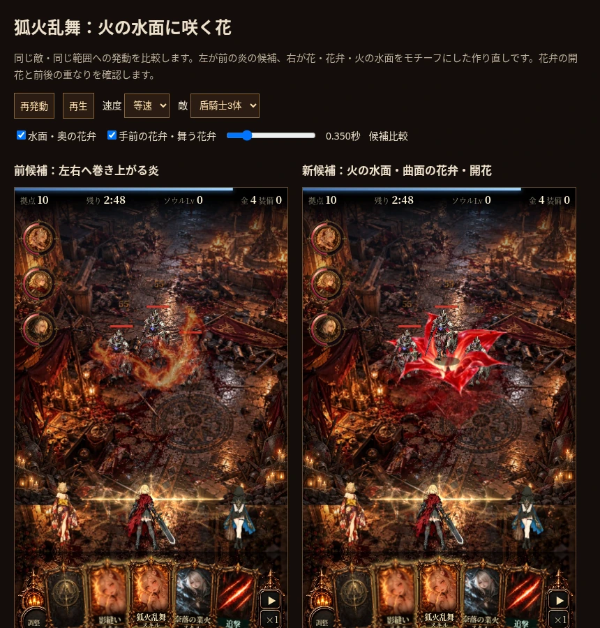
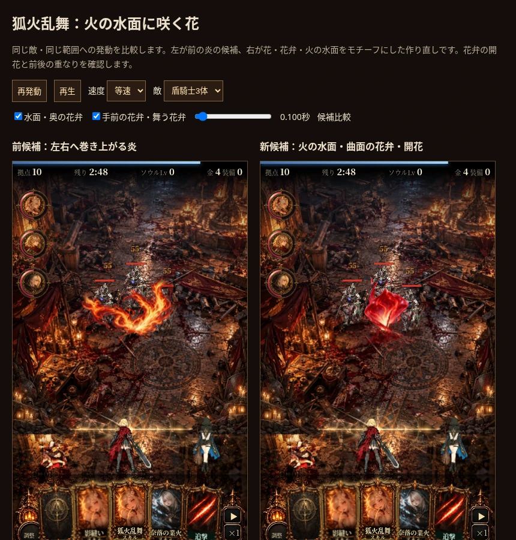
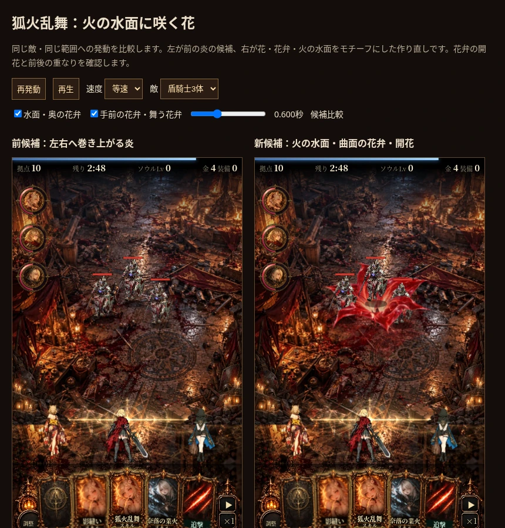
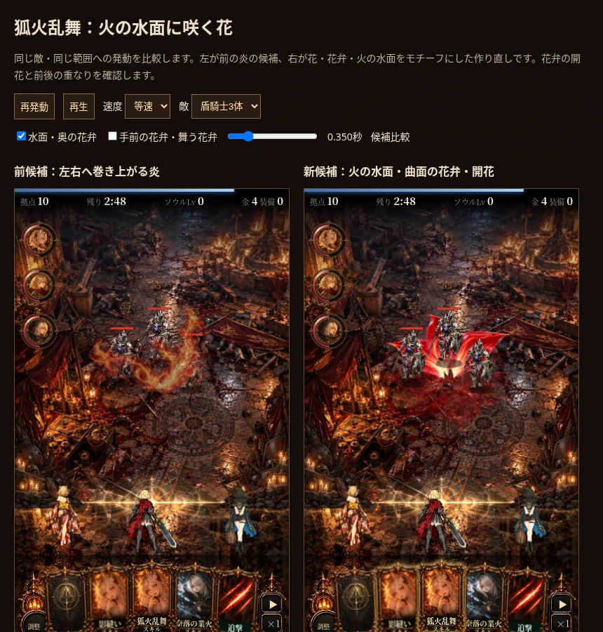

# 狐火乱舞：花・花弁・火の水面の前候補（2026-10-15）

**提示後の評価：方向性への肯定はあるが、花すぎて火の舞いが弱く、花の種類・開き方とキャラとの接続、整いすぎた粒子に問題がある。採用・改善成功として扱わない。** 最新の設計と生成物の自己レビューはdev/design/fox_fire_gust/。以下はこの前候補の制作・動作検証の履歴。

前候補への評価は「地味で平面的」。本案はその採用・改善成功を前提とせず、ユーザー指定の百鬼狐火のモチーフから構成し直した別候補。既存超必殺の08/20/36コマを実見し、赤く光る水面に咲く花と舞う花弁を参照した。

[30秒リピート比較：左は前の炎候補／右は今回の花・水面候補](fire-water-bloom-30s.mp4)

## 構成

専用に生成した2種類の花弁をGodot3Dの曲面メッシュへ貼り、6枚を異なる幅・長さ・傾き・時刻で開く。つぼみの立ち上がり→外への開花→小さな花弁が離れて旋回・落下→水面が残り消える。手前と奥の花弁を分け、敵が間にいるよう合成する。単一の完成した花の画像を拡大・フェードする方式ではない。

水面は別の専用液体原画を移流・変形し、3Dの微小なうねりと花弁の鏡像を加える。初回自己レビューでは花が小さく水面が線の輪に寄っていたため、花弁の面積・光量を調整し、線だけの水面を液体素材へ差し替えた。主役は赤・白桃色の花弁。前の橙色の炎や煙の拡大ではない。

ブラウザーへGodotを移植せず、69コマ／1.8秒、最初0.5秒60fps・以後30fpsのアトラスとして組み込む。Godotでの3D制作自体を品質の証明とはしない。

## 実画面で確認したことと限界

0.035・0.1・0.2・0.35・0.6・1.3・1.75秒、奥／手前単独、盾騎士3体・大鬼・女王を確認。0.1秒では閉じた花弁が立ち上がり、0.35秒には開いた花弁が敵の背後と足元の前へ分かれる。0.6秒には花が収束し、小さな花弁と水面へ移る。1.3秒以降の赤い水面は控えめ。水面の規則的な輪の線は専用液体への差し替えで除去した。

色と形は花の存在を強く見せる候補で、前案の炎の荒々しさをそのまま継承していない。小画面では花弁の材質の細部と反射は弱くなる。奥／手前の二層なので、敵一体ごとに厳密な3D遮蔽を計算するものでもない。ユーザーによる品質・採用の評価は未確認。実機Safari性能も未確認。

## 検証

- 同じJS統合に対し、従来／開花候補を3シード（1,77,4242）各30秒で比較。HP・敵HPと座標・撃破数・報酬・統計・スキル札が一致。
- 0.15秒では未命中、10/60秒で範囲内2体が1000→945・境界外1体は1000。装填5秒。
- 二重詠唱で同じ2体へ追加33ダメージ、HP912。候補の床／空中2件、寿命終了後0件。
- 百鬼狐火へ新候補を誤適用しない。未読込時は従来の爆発へ戻る。無効時は開花用アトラスを復号しない。
- HTMLとGodotの69コマ・時刻表・寿命が一致。コマ間の画素変化、一定色の中間補間でRGBA一致、最後に透明となることを確認。
- 最終水面素材への差し替え後、比較画像・等速動画・375×667と393×852を再撮影し、JSエラーなし。補間検証も再実行。戦闘ロジックは差し替えで変更していない。

ダメージ55・命中0.16秒・半径72・装填5秒は維持。ダメージは全範囲へ先に確定し、その後に花が開く。1.8秒の残留に追加ダメージなし。

## 入口・容量・採用状態

`?foxfirefx=bloom`が今回、`?foxfirefx=godot`が前の炎候補、標準は従来。`?hitfx=godot`併用で通常着弾・共通被弾も候補にできる。比較 `dev/mock/fox_bloom_demo.html`。PR #2の作業ブランチに追加、Pages公開・通常採用はしていない。

新しい2枚のアトラスは合計1,446,688bytes、復号28,901,376bytes、共有補間Canvas200,704bytes。選択した候補の2枚だけを復号するが、単一配布HTMLには各候補のdata URLを含む。

制作 `dev/godot/fox_bloom/README.md`、原画と指示・出典 `dev/godot/fox_bloom/art/README.md`、検証 `dev/tests/fox_bloom.py` と `dev/tests/fox_bloom_continuity.py`。Jettelly・Kenneyは前の試作に残し、新候補では花と水面の専用素材を使用する。
