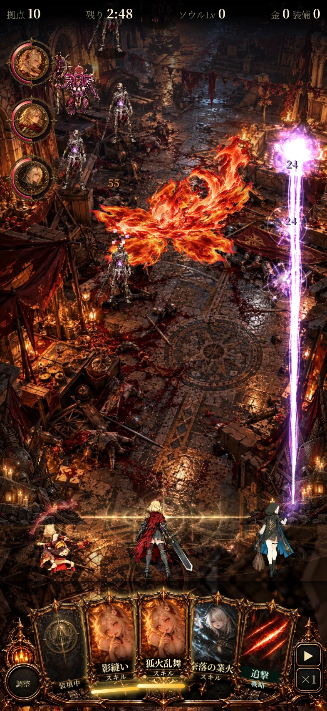
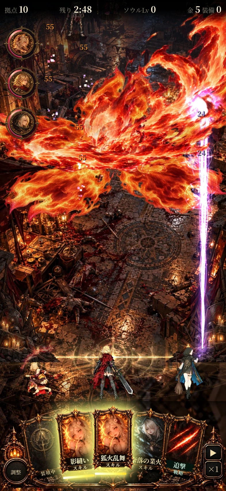

# 桜の狐火：通常プレイへの組み込み（2026-10-15）

ユーザーの実装指示を受け、作業ブランチの `index.html` をフラグなしで開いた場合にも、新しい桜の狐火を使う設定にした。

素材の選択と演出の選択を `FOX_FIRE_MODE` へ共通化し、初期値をgustにした。`?foxfirefx=legacy` は従来の狐火乱舞。gust-v1／godot／bloomの明示指定も比較用に保持する。通常着弾・共通被弾・百鬼狐火は今回の標準切替に含めない。

`dev/tests/fox_sakura.py --base-url http://127.0.0.1:8007` で、クエリなしのゲーム本体を検証。結果は [checks.json](checks.json)。

- クエリなしで新しい演出を選択し、必要な4素材を使用。過去候補を同時復号しない。
- 通常と爆心拡大4段のそれぞれで、従来演出と3シード各30秒の戦闘状態を比較。
- 命中前後、範囲の内外、55ダメージ、二重詠唱33ダメージ、装填5秒、寿命終了、超必殺の除外、素材未読込時のフォールバックを確認。
- 375／393px幅・DPR2のクエリなしの画面で、通常と最大範囲を確認。画像取得時だけ強化画面の自動表示と開始バナーを抑えて、演出を読める状態にした。戦闘比較・境界のテストにはこの抑制を使わない。JSエラーなし。

今回は標準設定への組み込み。素材・1280px合成・命中仕様は前の版から変更していない。[解像度と容量の測定](../fox-sakura/REPORT.md)を引き継ぐ。作業ブランチで動く状態と、mainへのマージ・Pages公開を区別する。実機Safari性能は未確認。
