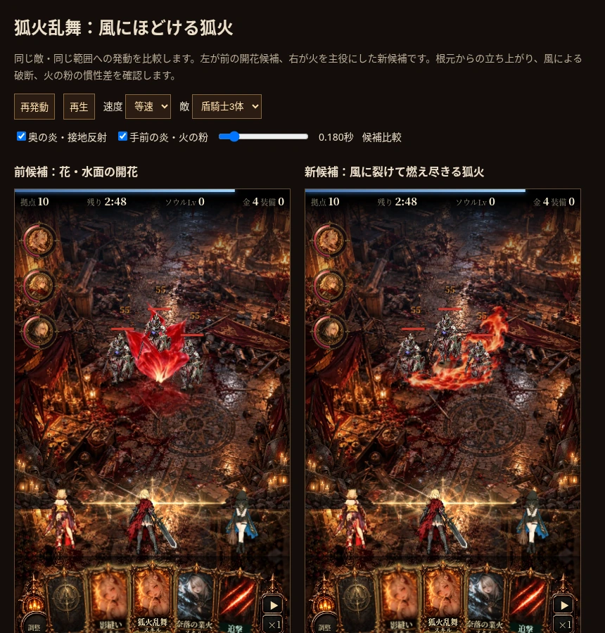

# 狐火乱舞：風にほどける狐火の制作レビュー（2026-10-15）

この記録は桜を強める前の初版。再現フラグは現在 `?foxfirefx=gust-v1`。最新は `dev/reports/fox-sakura/REPORT.md`。

設計パッケージから、ゲーム上で動く最初の候補を制作した。`?foxfirefx=gust-v1`、[比較ページ](../../mock/fox_gust_demo.html)、[30秒リピート](wind-fire-30s.mp4)。左は前の開花、右が今回の狐火。時間表示は命中後。新しい候補を通常採用したという記録ではない。

## コンセプトとの照合と修正

| 基準 | 観察・修正 | 判定 |
| --- | --- | --- |
| 花より火が先に読める | 花弁の開閉を廃止。熱い根元と薄い先端を持つ生成素材を格子メッシュと移流・浸食で構成した | 前の花の模型状の輪郭は解消。火としての候補に進める |
| 根元から奥の上昇流、手前の低い炎へつながる | 初版は右の大きな巻き上がりだけが強く中央が薄かった。右の面積を抑え、中央の短い上昇炎を足した | 密度と前後の重なりを改善。厳密な3Dの遮蔽ではない |
| 固定した形のフェードだけで終わらない | 首付近の局所浸食を追加。接触芯の切り出し角も柔らかいマスクで除去。先端の変形、移流、穴の消費、独立した裂片の移動を分けた | .1／.18／.30／.48秒の連続画像で輪郭の破断と燃え尽きを確認 |
| 火の粉が一律に散らない | 2つの発生点・3群・異なる発生時刻と寿命。共通の突風へ抗力と質量の違いで追従 | 均等な放射・同じ放物線の仕組みを廃止。小画面では小火の粉の差は控えめ |
| 水面は短い接地反射 | 初版の短い直線筋は人工的だったため不採用。生成済み水面を局所の薄い反射へ置換し移流を追加 | 閉じた池・常設円環を残さない。煙は薄く後から出す |
| 暖色と光量、敵の視認性 | 短い接触芯、炎の橙朱と暗部を残し、全画面フラッシュは使わない。騎士3体・大鬼・女王、375／393幅で確認 | ピークでも敵の頭と周囲を読める。炎の面積を無制限には増やさない |
| 桜の気配 | 丸い燃焼裂片と短い切れ目を使用 | 明確な桜の連想は未達。花形を増やして解決済みとは扱わない |

原画の全体構図をそのまま採用していない。強い白や大きな爆発形は持ち込まず、火の材質と用途別の形を部分採用した。ここにある画像と動画は実際のCanvasゲーム上の比較であり、先の生成原画とは区別する。

## 検証

- `checks.json`：3シード各30秒の戦闘状態一致。命中前と命中後、55ダメージ、半径72＋敵半径の境界、装填5秒、二重詠唱33ダメージ、寿命の片付け、超必殺の除外、未読込フォールバック、JSエラーと小画面を確認。
- `continuity.json`：初動60fps、実コマ間の変化あり。一定RGBAのテストで補間中の暗落ちなし。1.399秒の終端透明。
- `frame-checks.json`：全57コマ×2レイヤの外周透明、最終コマ透明。見切れと突然の末尾カットを検査。
- `dev/godot/fox_gust/atlas.json`：2枚合計599,324 bytes、復号25,690,112 bytes、補間Canvas200,704 bytes。標準は候補を復号せず、gust時は他のスキル候補を復号しない。配布用HTMLには他候補とともにデータが含まれる。

検証はブラウザーと画像列によるもの。実機Safariの性能、商用MMO相当の品質、ユーザーの採用判断は未確認。火の粉は小さな画面では微細であり、桜の連想にも改善余地がある。流体シミュレーションではなく、生成素材の変形と共通の風を使った演出。

制作コード・再生成手順と素材の来歴は [fox_gust/README.md](../../godot/fox_gust/README.md)。新規生成は行わず、前工程で自己レビューした素材を使って制作した。
