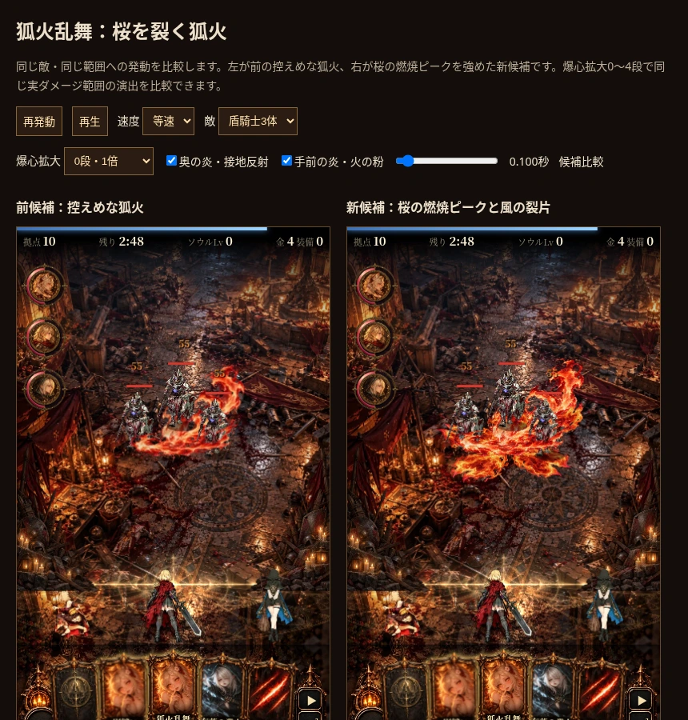
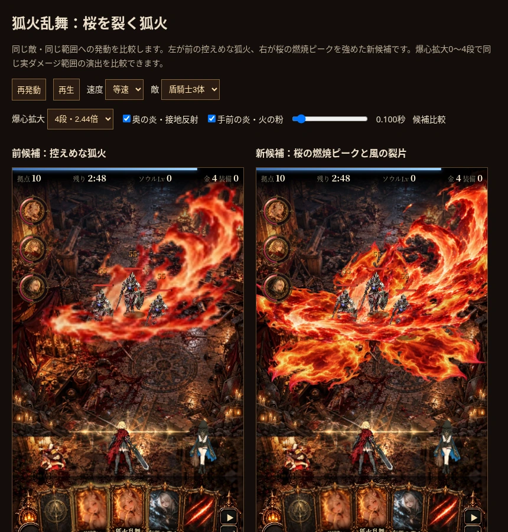

# 桜の燃焼ピークと最大範囲の制作レビュー（2026-10-15）

ユーザー評価「通常攻撃っぽい、桜の気配を派手にしてよい」に対応した改訂候補。[30秒リピート比較](sakura-fire-30s.mp4)は通常倍率と最大倍率を交互に再生する。前の控えめな狐火を `?foxfirefx=gust-v1`、新候補を `?foxfirefx=gust` で比較できる。[比較ページ](../../mock/fox_sakura_demo.html)には爆心拡大0〜4段の切替を追加した。

## 見た目のレビュー

- 生成した五つの裂け目を持つ炎から、短い桜状の燃焼ピークを追加。火の材質と切れ込みを採り、全形を保持する紋章やゆっくり開く植物は採らない。命中後.12秒から浸食が進み、.23–.43秒で全体も崩れる。
- 奥の炎と手前の低い炎も広げた。通常倍率で前候補より足元の面積と発光の強弱が出る。花弁メッシュの再採用ではない。
- 火の粉43個に加え、燃焼する裂片を14枚追加。違う抗力・慣性・寿命で同じ風を受け、静止した全形から離れる。小粒と同じ大きさでは埋もれるため、燃焼片の表示サイズを強めた。
- 最大拡大では広い面積が画面外へ出る。これは半径が戦場の約半幅へ届く現仕様によるもの。敵の頭と体の重なりを確認し、全画面フラッシュや残留への追加ダメージは使わない。

全形だけの生成画像を完成演出として採用していない。[生成指示と採否](../../design/fox_fire_gust/SAKURA_REVISION.md)を参照する。

## 解像度の回答

以前の224px連番と224pxの中間合成では最大拡大時の細部は不足していた。今回は1280pxで直接再レンダリングし、火の粉・燃焼片はCanvasへ個別描画する。主炎を192pxの区画へ分けて透明な余白を除去し、1280pxの合成面へ1:1で復元する。

| 条件 | 通常 | 爆心拡大4段 |
| --- | ---: | ---: |
| 半径の倍率 | 1 | 2.44140625 |
| 半径（論理単位） | 72 | 175.78125 |
| 演出領域の描画幅（論理単位） | 230.4 | 562.5 |
| 393px画面・DPR2で必要な横画素 | 約503 | 約1228 |
| 新しい素材・中間合成の横画素 | 1280 | 1280 |

375／393pxの画面幅・DPR2で0〜4段すべてを測定し、素材の引き伸ばしが不要なことを `resolution.json` に記録。端末DPRが3でも現ゲームはCanvasのDPRを2に制限する。ゲームの最大表示幅520px・DPR2では最大約1625pxが必要になり、1280pxから約1.27倍の拡大が残る。スマホで確認した393px幅までの結果を、全画面幅への保証に拡大しない。

## 容量と性能の区別

主炎のアトラスは奥4096×3744、手前1792×2796。2枚合計の復号メモリは81,383,424 bytes（約77.6MiB）、合成面6,553,600 bytes（6.25MiB）。別途、小さい燃焼片2枚、光の補助Canvas、軌道の配列がある。旧2アトラスの約24.5MiBより増える。1280pxの正方形を57コマ×2層のまま並べる約712.5MiB（8×8固定格子なら800MiB）の構成は避けている。

連番2枚は11,054,812 bytes。明示legacyと他の比較候補では新素材を復号せず、新候補でも旧候補を同時復号しない。現在はフラグなしの通常モードも新候補gustを使う。ただし配布HTMLには各候補の画像データが含まれる。画素密度の確認と、実機Safariでのメモリ・フレーム時間の確認を同一視しない。実機性能は未確認。

## 検証と再現

- `frame-checks.json`：全57コマ×2層を区画から復元し、原書き出しのアルファと一致（1/255以下の透明度のみ除去）。画像端の見切れなし、最終コマ透明。各アトラスは4096px以内。
- `resolution.json`：375／393幅・DPR2・爆心拡大0〜4段の実描画サイズ、元画素数、中間合成サイズ、不要素材を復号しないことを記録。
- `checks.json`：通常と最大拡大の戦闘状態比較、半径の境界、時刻、二重詠唱、寿命、フォールバック、小画面、JSエラー。
- `continuity.json`：コマ間の変化、一定RGBAでの補間の暗落ち、燃焼片の残留描画、終端透明。

[制作・再現手順](../../godot/fox_gust/README.md)。後続のユーザー指示で作業ブランチの通常プレイに採用。フラグなしの検証は `dev/reports/fox-default/`。mainへのマージ・Pages公開・実機Safari性能確認は未実施。

## 実装後の仕上げレビュー

カットインを保持した発動前からの追加確認と、始動・発光・ピーク・収束の採否は[FINISH_REVIEW.md](../fox-finish-review/FINISH_REVIEW.md)。この記録の命中後比較だけで通常プレイ全体の演出品質を合格にしない。
