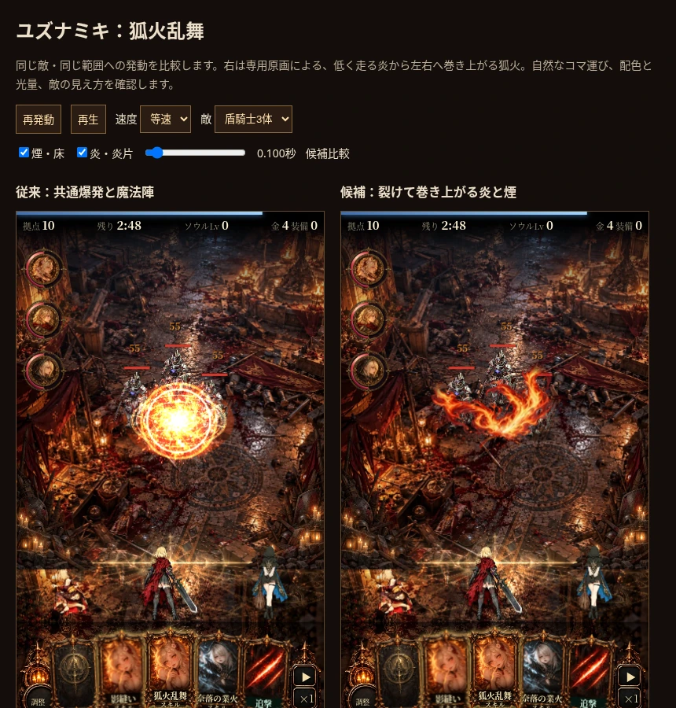
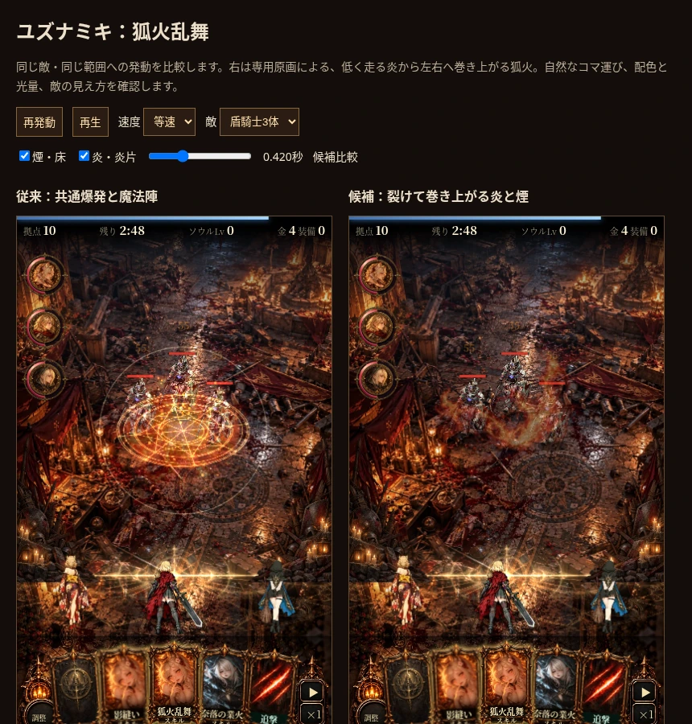

# ユズナミキ「狐火乱舞」候補（2026-10-15）

前回の通常着弾の方向性を了承いただき、スキルへ進む依頼に基づく候補。自然なコマ運び・配色・光量を優先した。新しい専用原画のつながった炎を、Godotで低い着火→左右で異なる巻き上がり→炎片と煙へ構成した。素材集はJettelly・Kenneyの補助の煙。通常着弾の拡大・均等な炎の反復ではない。

[等速比較動画：左従来／右候補](fox-fire-dance.mp4)

## 動き・配色・光量

主役の炎が命中点から約0.19秒で広がり、左右で異なる高さと速さで巻き上がる。小さな白桃色の芯から、橙・朱赤の中間調、暗い赤の外縁へ。全体の周期点滅で流動感を代用せず、局所UV移流と輪郭の浸食を使う。煙は薄く、紫は煙に限定。51コマ／1.35秒、初動0.4秒60fps・中盤30fps・消え際24fps、premultiplied RGBAのコマ間補間。

従来の共通爆発・魔法陣・直線ビームをこのスキルだけ置換。体の狐火と発動モーションは既存を維持。初撃に軽い振動だけを入れ、繰り返し全体を揺らさない。床の煙は敵の背面、炎・炎片は前面。

## 実画面レビュー

0.035・0.1・0.2・0.42・0.85・1.3秒、床／空中単独を確認。ピーク時も盾騎士3体の輪郭が残り、共通爆発の白い面から炎の形へ変わった。0.42秒以後は暗い赤から煙へ収束する。大鬼・女王でも局所の炎として読める。形は非対称なので、炎の絵が一瞬に範囲全体のすべての敵へ接触する表現ではない。全範囲への命中は既に確定済みで、その後の伝播は演出。

明るい背景で煙は控えめ。元絵の大きな巻き上がりの輪郭は残るため、さらに長時間燃え続ける技へそのまま流用しない。専用被弾ポーズと実機Safariの負荷は未確認。商用MMOと同等品質を検証したものではない。

## 戦闘と動作の検証

- 3シード（1,77,4242）各30秒、従来／候補でHP・敵HPと座標・撃破数・報酬・統計・スキル札が一致。
- 使用後0.15秒ではHP1000のまま、10/60秒では範囲内2体が945・境界外1体が1000。半径72＋敵半径16の境界88の内外を確認。装填5秒。
- 二重詠唱では同じ2体へ追加33ダメージ、HP912。威力・時刻の追加変更なし。
- 候補は床／空中2件、演出時計を進めると寿命終了後0件。シミュレーターの戦闘時計とFX時計は独立しているため、寿命検証ではFX時計も進める。
- 百鬼狐火では新スキル候補を出さない。素材欠落時は従来の爆発へ戻る。標準ではスキル用アトラスを復号しない。
- 375×667と393×852、停止・スロー・時間指定・レイヤ切替・敵切替を確認。JSエラーなし。
- HTMLのコマ数・時刻表・寿命とGodotのメタ情報が一致。コマ間でも描画が変化し、一定色を補間した中間のRGBAは開始と一致。最後は透明へ連続することを検証（continuity.json）。

ダメージは発動0.16秒後に全範囲へ確定し、その後に見た目の炎が広がる。煙と炎の残留に追加ダメージなし。通常攻撃と他スキル・超必殺の戦闘処理は維持。

## 素材・容量・入口

生成原画と指示・出典：`dev/godot/fox_skill/art/README.md`。JettellyとKenneyのCC0ライセンスは既存の `dev/godot/fox/art/` に同梱済み。主役の原画の接地点は生成指示通りでなかったため、実際の(.59,.80)に合わせた。

2アトラス643,414bytes、復号22,478,848bytes、共有補間Canvas200,704bytes。発動ごとの画像・Canvas生成なし。フラグ無効時はこの2枚を復号しないが、単一配布HTMLには素材のdata URLを含む。

候補 `?foxfirefx=godot`。通常着弾と共通被弾も候補にする場合 `?hitfx=godot&foxfirefx=godot`。比較 `dev/mock/fox_skill_demo.html`。通常ゲーム採用・Pages公開は未実施、作業ブランチ／PR #2に追加した候補。

再制作手順 `dev/godot/fox_skill/README.md`、検証 `dev/tests/fox_skill.py`、`dev/tests/fox_skill_continuity.py`。続く対象は影縫いと百鬼狐火。
