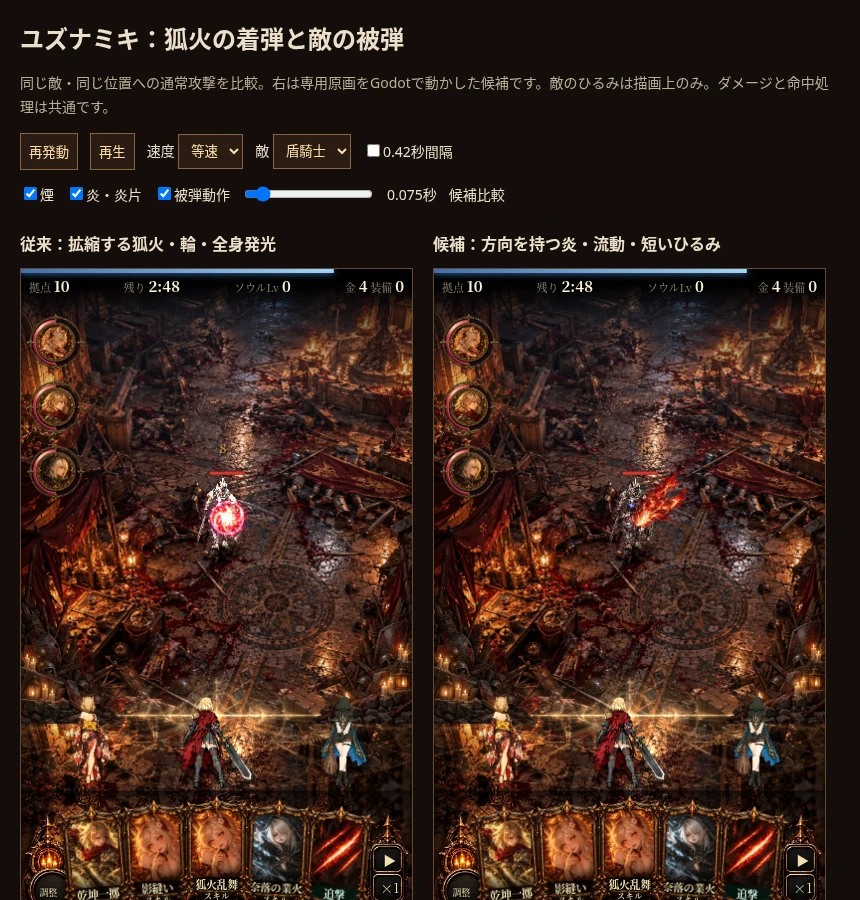

# 狐火の自然感調整：コマ・配色・光量（2026-10-14）

ユーザー評価「方向性は良い。重要なのはコマ割りによる自然感。ドット感というよりは自然な配色と光量メイン」に基づく調整。炎の専用原画と方向性は維持。

## 今回の変更

- 初動0.3秒の時間サンプルを40fpsから60fpsへ、後半の煙を20fpsから30fpsへ。全24→33コマ、寿命0.8秒を維持。
- 隣接コマをpremultiplied RGBAとして共有Canvas上で線形補間してから戦場へ合成。二重source-overのフェードで中間の光量が落ちることを避ける。最後は透明へつなぐ。
- 初動の拡大で炎の根元が動く問題を修正し、命中点に固定。加速も調整。
- 局所ノイズによる光量変化を±3%に抑える。短い明るい芯から朱赤の中間調へ冷める色変化を追加。発光の強さだけで流動感を作らない。
- Jettellyの煙タイルのUV変形を止め、隣のコマが混入するのを防ぐ。

比較画面 `dev/mock/fox_hit_demo.html` は左が前回候補、右が今回調整版。`?hitfx=godot-v1`で前回、`?hitfx=godot`で調整版。標準ゲームは従来表示のまま。PR #2の更新であり、Pages公開・通常採用はしていない。

[等速比較動画（左V1／右V2、60fpsで描画した比較記録）](natural-motion.mp4)

## 確認したこと

0.105→0.110秒の描画画素差：前回のコマ保持では0、調整版では34005。コマ間で形が変わっていることを確認。一定の炎を入力した検証では、開始と補間中間のRGBAがともに[229,100,30,128]で一致し、中間の暗化は発生しない。これは連続性と合成の検証で、知覚品質の保証とは区別する。

- 初回：変更前配布HTML（6a7c039）と候補、3シード各30秒で戦闘状態一致。
- 今回：同じ配布HTMLの従来フラグと調整版で再比較。3シード各30秒、HP・敵HPと座標・撃破・報酬・統計・スキル札が一致。
- 盾騎士／骸骨／大鬼／女王、0.025・0.075・0.15・0.55秒、0.42秒間隔を確認。375×667、393×852で描画。JSエラーなし。
- 新VFX・ひるみFXは寿命終了後0件。標準従来、素材未読込フォールバック、通常ダメージ8と座標不変を確認。
- 明るい芯が炎全体を白く覆う状態を避けつつ、命中方向の朱赤の輪郭を維持。煙は薄め。補間は形状のモーフィングではないため、速い先端が二重に見える可能性は引き続き実画面で評価する。専用被弾ポーズ・実機Safari性能は未確認。

調整版2枚277,554bytes・復号11,796,480bytes。比較用V1アトラスも同梱・ロードするため、その分を含めると復号18,874,368bytes。共有補間Canvasは192×192・147,456bytes、発動ごとには生成しない。

制作：`dev/godot/fox/README.md`。出典・CC0ライセンスと生成指示は維持。自然感の優先基準は `.agents/skills/naraku-vfx/SKILL.md` にも追加。

再検証：ゲームのディレクトリをHTTPで配信し `python3 dev/tests/godot_fox.py --base-url http://127.0.0.1:8000` と `python3 dev/tests/fox_continuity.py --base-url http://127.0.0.1:8000`。

この記録の主VFXはユズナミキ通常攻撃。2026-10-15に狐火乱舞の追加候補を制作（../fox-skill/REPORT.md）。影縫い・百鬼狐火の主演出は未改修。続く制作でも単純な拡大・等間隔反復にせず、技固有の動きと色・光量を構成する。
