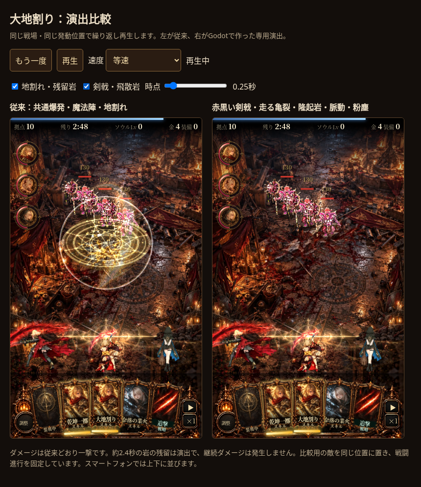
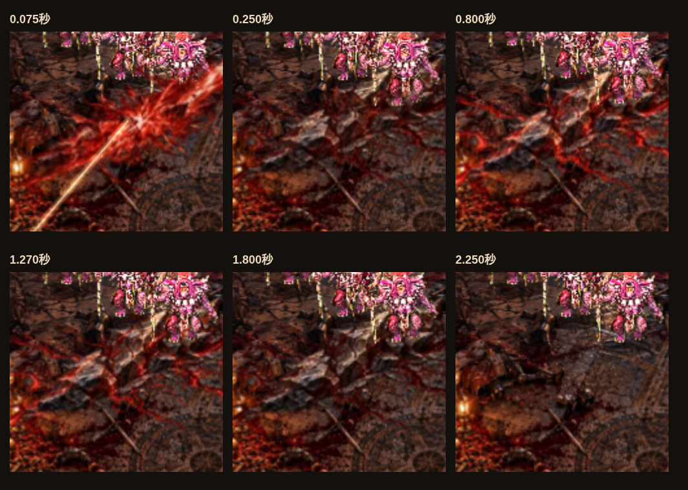

# 赤黒い地割れ：候補演出の確認

GPT Imageで亀裂と隆起岩を追加生成。既存原画とCC0のKenney煙・Jettelly煙マスクをGodot 4.6.3で合成。58コマ／2.4秒、床と空中の2層、配布1,030,912bytes、復号29,622,272bytes。

自己レビューで床の解像度を256pxへ上げ、発光の常時成分を抑えて脈動を強調、舞い上がる粉塵を追加。岩は1.8秒まで残り、その後沈んで崩れる。比較用の敵を置き、床が敵の背面に描かれることを確認。

3シードで従来版と戦闘状態一致。0.1秒時点は命中待ち、0.2秒時点は2層生成。375×667と393×852で8時点を撮影、JSエラーなし。Chromiumのフレーム中央値16.8／16.6ms、p95 18.4／19.8ms。実機スマートフォンの測定ではない。checks.json参照。

比較ページの再生・停止、スロー、時間指定、床／空中切替、2.4秒での片付けを確認。通常ゲームは従来演出、試作は?quakefx=godot。実ダメージは従来の1回、継続ダメージは追加しない。

2026-10-14 光量調整：斬撃の芯を明るくし、亀裂の光の常時成分・脈動を増幅。近傍の発光部分だけを抽出して淡い赤色のにじみを追加し、岩全体は明るくしない。演出時間と戦闘処理は維持。
