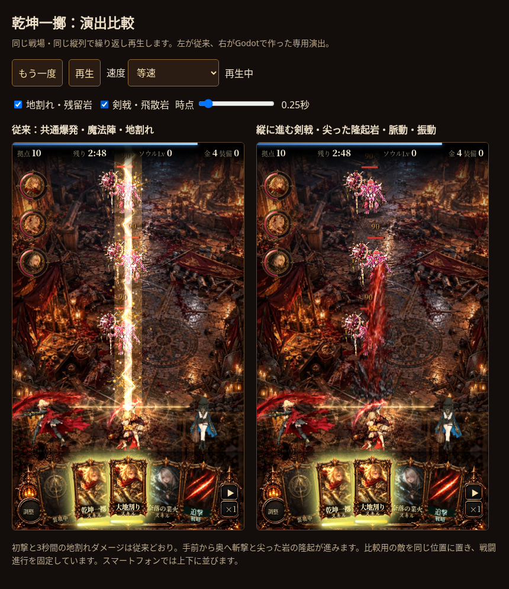
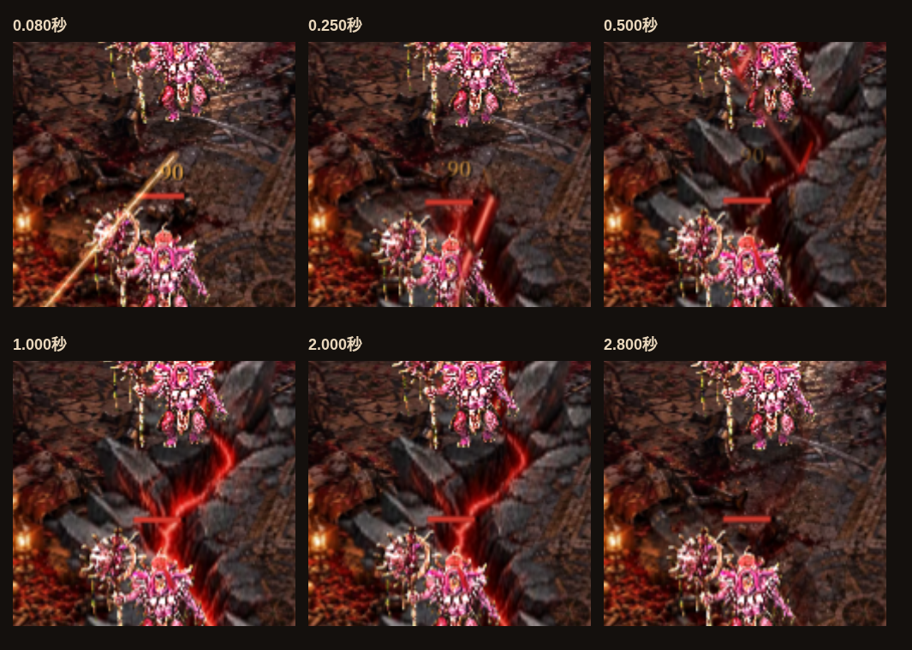
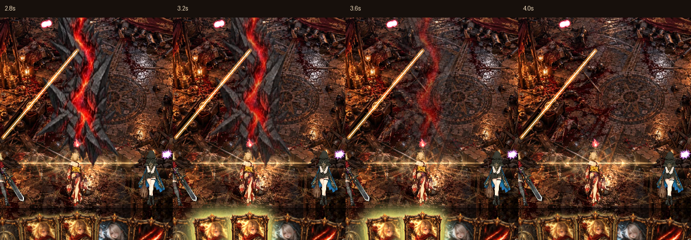

# 乾坤一擲：流動する赤い熱と不規則な尖岩

専用GPT Image原画rift_jagged.pngを追加。平たい岩盤の縁を減らし、尖った大小の岩に幅を使う。出現時に区間ごとの岩が外へ開く。周期的な全体点滅を廃止し、rift_flow.gdshaderで亀裂内部の低速の流れ・細かい渦による局所的な濃淡移動に変更。追い斬撃と画面振動も不均等な間隔と強さ。大地割の共通shaderは変更なし。

93コマ、初動25fps・消え際15fps、床／空中2層、配布1,562,180bytes、復号44,433,408bytes。2.8秒から滑らかに薄れ、4.2秒で消える。

3シードで従来版と戦闘状態一致、命中待ちと2層生成を確認。初撃・3秒継続ダメージ・鈍足・範囲は維持。比較ページ6時点、時間指定、表示切替、再生・停止、4.2秒での演出の片付けを確認。JSエラーなし。Chromiumでのフレーム測定はchecks.json参照、実機性能の測定ではない。

?riftfx=godotのみ候補有効、通常ゲームは従来。比較dev/mock/rift_demo.html。

消え際の確認：ダメージのzoneは3秒で終了、視覚の2層はその後も残り4.2秒で終了。2.8／3.2／3.6／4.0秒を撮影。

